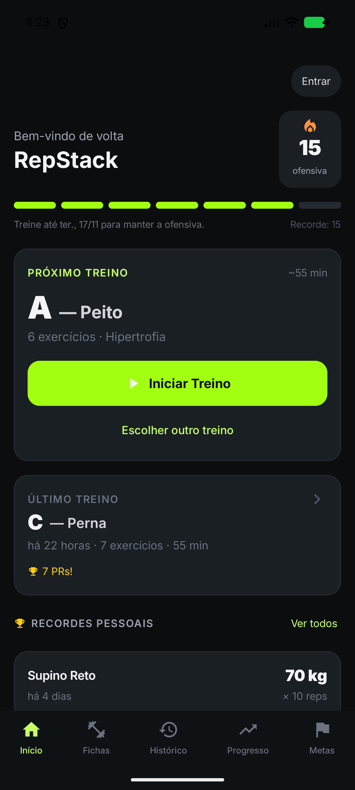
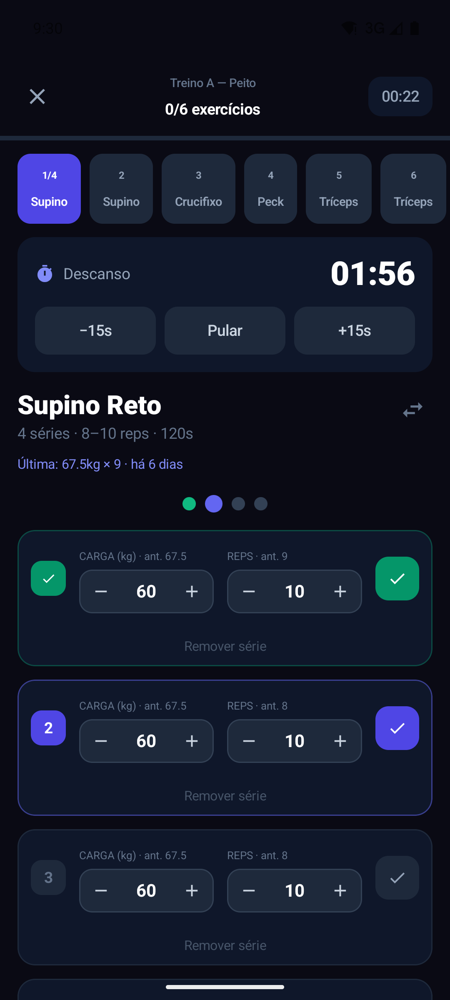
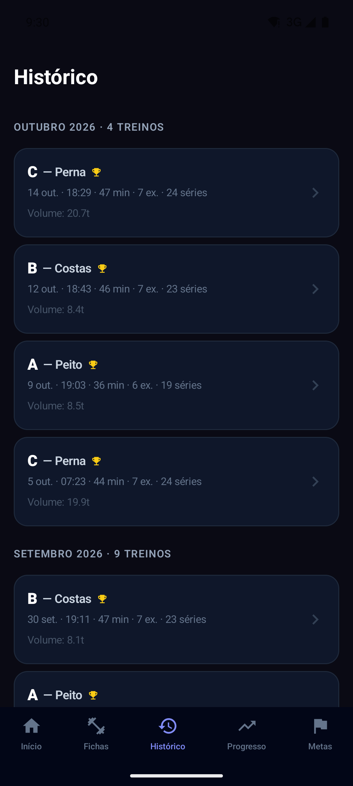
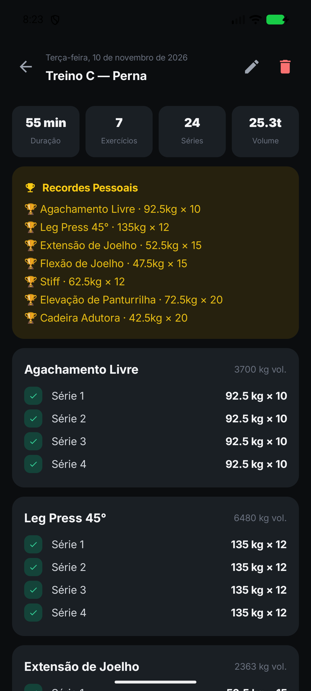
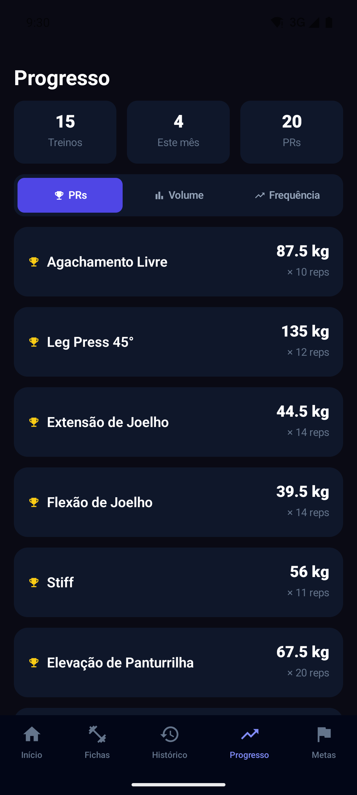
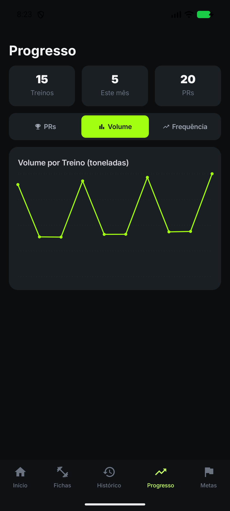
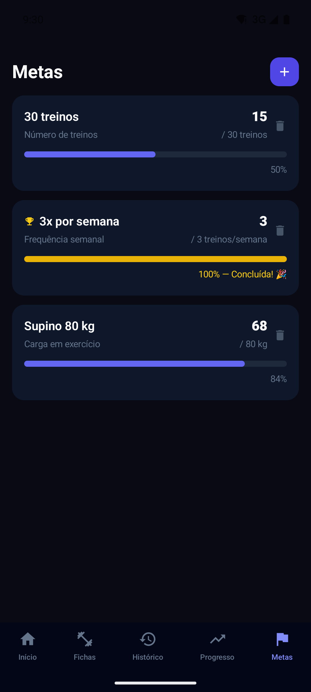

# RepStack

App Android nativo de acompanhamento de treinos de musculação, escrito em **Kotlin + Jetpack Compose**.
Offline-first: tudo fica no aparelho (Room) e, com login Google, sincroniza com o Firestore.

RepStack é o novo nome do GymTrack. O identificador Android `app.gabrielaraujo.gymtrack`,
o banco `track.db`, as preferências e os identificadores de sincronização foram preservados
para permitir atualizar instalações existentes. O componente Android do widget mantém seu
nome antigo para preservar widgets já adicionados à tela inicial.

A landing page está em `docs/landing.html`. Ela usa o símbolo do pacote de marca e Inter
hospedada em `docs/assets/`; a licença da fonte acompanha o site e o APK.

## Telas

Capturas do RepStack com dados de demonstração, atualizadas em 11/11/2026.

<p align="center">
  
  
  
</p>
<p align="center">
  
  
  
</p>
<p align="center">
  
</p>

## Stack

- **Kotlin** + **Jetpack Compose** (Material 3, tema dark)
- **Room** para persistência local (`track.db`), com o schema versionado em `app/schemas/`
- **kotlinx.serialization** para as estruturas aninhadas (dias/séries) e para backup/sincronização
- **Firebase Auth** (login Google via Credential Manager) + **Cloud Firestore** para sincronização
- **Health Connect** para trocar dados com o Samsung Health, Google Fit e similares (opcional)
- `ViewModel` + `StateFlow` alimentados por `Flow`s do Room (MVVM)
- `minSdk` 26 · `targetSdk` 35 · `compileSdk` 36

## Funcionalidades

- **Início** — próximo treino do ciclo, ofensiva, último treino, recordes pessoais e estatísticas
- **Ofensiva** — cada treino concluído soma +1; ficar mais de 7 dias sem treinar zera a contagem
  (mínimo de 1 treino por semana). A tela mostra até quando treinar para manter a sequência
- **Fichas** — criar/editar/duplicar/ativar/excluir; importar e exportar em JSON
- **Execução** — abas por exercício, registro de séries (carga/reps), substituição de exercício,
  sugestão de progressão de carga, resumo ao finalizar
- **Timer de descanso** — continua com a tela bloqueada/app em segundo plano (foreground service)
  e avisa com vibração e notificação quando acaba
- **Histórico** — sessões agrupadas por mês; cada treino pode ser **editado** ou **excluído**
  (volume, recordes e ofensiva são recalculados)
- **Progresso** — recordes, evolução de carga, volume, frequência e peso corporal (gráficos em Canvas)
- **Metas** — metas de treinos/frequência/volume/peso corporal com barra de progresso
- **Samsung Health / Health Connect** — veja abaixo
- **Conta** — login Google, status da sincronização (pendências/erros) e "Sincronizar agora"
- **Backup** — exporta/importa tudo (fichas, histórico, recordes, metas, exercícios personalizados)
  em JSON; também importa o backup do app web antigo
- **Widget** — ofensiva e próximo treino na tela inicial

Na primeira execução, o banco é semeado com ~45 exercícios e uma ficha exemplo "Hipertrofia" (A/B/C).

## Samsung Health e Health Connect

Não há integração direta com o Samsung Health: ele sincroniza com o **Health Connect** nos dois
sentidos, e o RepStack lê e grava lá. As duas opções ficam na tela de conta e são independentes:

- **Enviar treinos concluídos** — grava cada treino como `ExerciseSessionRecord` (treino de força,
  com as séries nas notas). Edições e exclusões do histórico também são enviadas. A tela mostra o
  resultado do último envio.
- **Importar do relógio** — lê a frequência cardíaca (média/máxima) e as calorias medidas durante o
  treino e o peso corporal. As medidas ficam salvas no treino (resumo e histórico) e sincronizam; o
  peso alimenta a aba "Peso" do Progresso e as metas de peso corporal. Como o Galaxy Watch sincroniza
  com atraso, os treinos dos últimos 3 dias são consultados de novo sempre que o app volta ao primeiro
  plano (no máximo a cada 5 min); ao ligar a importação, o último mês inteiro é buscado.

Para os treinos aparecerem no Samsung Health, ele precisa ter permissão para **ler "Exercício"** no
Health Connect e a sincronização ligada em Samsung Health › Configurações › Health Connect. O app traz
esse passo a passo, com atalhos, quando o Samsung Health está instalado.

Limitações:

- O Samsung Health só grava calorias no Health Connect para exercícios registrados nele (ex.: um treino
  iniciado no relógio). Sem isso, o treino do RepStack fica sem calorias.
- A frequência cardíaca depende de quantas medições o relógio fez: com a medição a cada 10 minutos,
  um treino pode ter menos de 3 medições e ficar sem FC. Medir continuamente resolve.
- A leitura só é permitida com o app em primeiro plano, e o Health Connect só libera dados de até
  30 dias antes da primeira permissão.

## Build

Requer o Android SDK (`local.properties` aponta para `sdk.dir`), JDK 17 e o `app/google-services.json`
do projeto Firebase (fora do git).

```bash
./gradlew :app:testDebugUnitTest   # testes (JUnit + Robolectric)
./gradlew :app:assembleDebug       # APK de debug
./gradlew :app:assembleRelease     # APK de release (R8 + shrink de recursos)
./gradlew installDebug             # instala em um dispositivo/emulador conectado
```

O APK sai em `app/build/outputs/apk/<tipo>/`.

### Assinatura do release

Crie `keystore.properties` na raiz (já ignorado pelo git):

```properties
storeFile=caminho/para/gymtrack.jks
storePassword=...
keyAlias=...
keyPassword=...
```

Ou use as variáveis de ambiente `GYMTRACK_KEYSTORE_FILE`, `GYMTRACK_KEYSTORE_PASSWORD`,
`GYMTRACK_KEY_ALIAS` e `GYMTRACK_KEY_PASSWORD`. Sem elas, o release sai sem assinatura.

## CI

`.github/workflows/ci.yml` roda a cada push/PR: testes unitários, build debug, build release e
verificação de que o schema do Room está commitado. O APK de debug fica como artefato da execução.
Para usar o Firebase real no CI, cadastre o conteúdo do `google-services.json` no secret
`GOOGLE_SERVICES_JSON`; sem ele o CI usa um placeholder só para compilar.

## Banco de dados e migrações

O Room exporta o schema de cada versão para `app/schemas/`. **Não há fallback destrutivo**: ao
mudar qualquer `@Entity`, é obrigatório

1. subir `RepStackDatabase.VERSION`;
2. rodar o build para gerar o novo JSON em `app/schemas/` e commitá-lo;
3. adicionar a migração em `RepStackDatabase.MIGRATIONS` (ou um `@AutoMigration` se for só aditiva).

Sem isso o app falha ao abrir em vez de apagar os treinos do usuário (e o CI acusa o schema não commitado).

## Sincronização

Estrutura no Firestore: `users/{uid}/{plans|sessions|prs|goals|exercises}/{id}`, cada documento com
`{ updatedAt, serverUpdatedAt, deleted, json }`.

- Conflitos: last-write-wins por `updatedAt`.
- Pull incremental pelo `serverUpdatedAt` (hora do servidor), então relógios desajustados entre
  aparelhos não fazem mudanças se perderem.
- Push em lotes (`WriteBatch`); o `dirty` só é limpo se o registro não mudou durante o envio.
- Exclusões são tombstones (`deleted = true`) para propagar entre aparelhos.
- Treinos em andamento nunca sobem; só os concluídos.

## Estrutura

```
app/src/main/java/app/gabrielaraujo/gymtrack/
├── auth/        # login Google + Firebase Auth (AuthGateway)
├── data/        # entidades Room, DAO (com Flows), repositório, seed, ids
├── domain/      # regras puras e testáveis: ofensiva, recordes, backup
├── sync/        # SyncEngine (Firestore) e status da sincronização
├── session/     # timer de descanso (foreground service)
├── health/      # Health Connect (envio de treinos, leitura do relógio) e atalhos do Samsung Health
├── widget/      # widget da tela inicial
└── ui/
    ├── theme/        # paleta, tipografia, tema
    ├── components/   # Card, botões, stepper, gráfico, ofensiva, status de sync
    ├── screens/      # Início, Fichas, Editor, Execução, Resumo, Histórico, Progresso, Metas
    ├── RepStackApp.kt        # navegação + bottom bar
    └── RepStackViewModel.kt  # estado de tela e orquestração
app/src/test/    # testes JUnit (domain) e Robolectric (ViewModel + Room em memória)
app/schemas/     # schema do Room por versão
```

## Publicar a landing na Vercel

Produção: https://repstack-rho.vercel.app — projeto `gbaraujos-projects/repstack`.

A página é estática. O script abaixo monta `dist/` com `index.html` e somente os
recursos públicos usados pela landing; o aplicativo e os documentos internos
ficam fora da publicação.

```powershell
node scripts/build-landing.mjs
npx.cmd --yes vercel@65.14.0 login
npx.cmd --yes vercel@65.14.0 link --cwd dist --project repstack --scope gbaraujos-projects --yes
npx.cmd --yes vercel@65.14.0 deploy --cwd dist --prod --yes
```

Nos próximos deploys, execute novamente o script e o comando `deploy`. A pasta
`dist/` e o vínculo local `.vercel/` são ignorados pelo Git.
A publicação é feita pela CLI; pushes no GitHub não disparam deploy automático.
